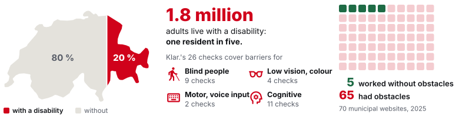
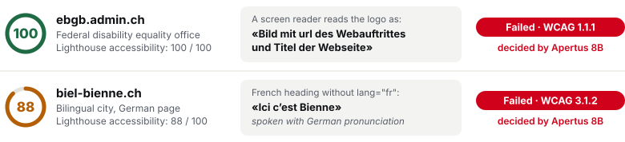
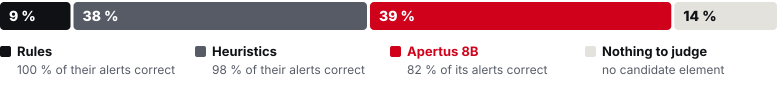
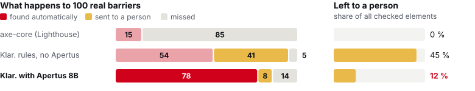

# Technical report — Klar.

**Meaning checks for an accessible Swiss web, with Apertus**

- **Track:** Track 2B — Klar.
- **Event:** Online
- **Team:** Klar — Mehdi Taleb (solo founder)
- **Demo:** <https://youtu.be/N6FVKlYc3lY> (2 min)
- **Code:** <https://github.com/0uternet/klar> (Apache-2.0) · **Dataset:** `track_2b/data/testset` (CDLA-Permissive-2.0; ACT cases under the W3C licence) · **Model:** Apertus v1.5 8B on-premise (70B in one comparison run)

## 1. Summary

**The problem.** One resident in five in Switzerland lives with a disability [1]. For many, a public website is the only way to a service: a tax return, a waste calendar, a census. Yet in 2025 only 5 of 70 municipal websites worked with a screen reader without obstacles [2]. In 2023, blind residents could not complete the federal census survey, the one survey the law obliges them to answer: the screen reader did not say which answer was selected [3].

**Why today's tools miss it.** Automated scanners such as axe-core, the open-source engine inside Google Lighthouse and most browser extensions [4], test what a machine can decide for sure: an image has a text alternative, a contrast ratio is high enough. They cannot tell whether the alternative *makes sense*. In an independent test the best tool found 40 % of planted barriers [5], and the W3C lists none of the five "is it descriptive" rules [6–10] for axe-core [11]. Expert audits judge meaning, but cost CHF 3,800–8,500 and take about four weeks [12], while sites change every week.

**Klar.** pre-checks what scanners cannot judge, with Apertus, inside the organisation. Code measures every fact and settles the clear cases. Apertus answers one closed question per element that needs judgement, and must quote the page. A person accepts or rejects each finding. Klar. covers 26 of the 50 WCAG 2.1 A/AA criteria [13] required by the Swiss standard eCH-0059 [14, 15] in German, French and Italian. It flags; it does not certify.

<figure class="fig-wide">

<figcaption><b>Figure 1. The people, the gap, the scope.</b> Sources: BFS [1]; CORRECTIV with Stiftung Zugang für alle [2]. Each criterion is counted once, under the group it serves first; most serve several.</figcaption>
</figure>

**Results** on 605 test cases written and frozen before the first test run (§5):

- **5× more barriers found than axe-core** on these criteria: 78 % against 15 %, with 93 % of alerts correct.
- **73 % less manual review** than the same rules without Apertus: a person checks 12 % of elements instead of 45 %.
- **Half a centime per page** on one on-premise GPU: a 300-page site in under two hours; no page leaves the building.
- **The trade-off, stated plainly:** rules alone miss fewer barriers (5 % against 14 %) only because they hand 45 % of elements to a person. §5 shows where Apertus errs.

On live public pages, Apertus found barriers that a perfect Lighthouse score hides (Figure 2).

<figure class="fig-wide">

<figcaption><b>Figure 2. What a perfect score can hide.</b> Live scans, 15 October 2026, Lighthouse 13.5 [16]. Both findings were confirmed by a person.</figcaption>
</figure>

## 2. Architecture

Klar. runs as two containers (Figure 3). The `app` holds Python 3.12 (FastAPI), Playwright with Chromium, the vendored axe-core 4.13.0 [4] and a Vue 3 interface in EN/DE/FR/IT. The model runs in a second container (vLLM [17] on a GPU, llama.cpp on a CPU) or behind any OpenAI-compatible endpoint.

1. **Capture.** Chromium renders the page and records the DOM, the names a screen reader would announce, the language of each element and image crops.
2. **Facts, in code.** axe-core runs its A/AA rules. One module per criterion computes what the W3C texts ask for [18–20]: unrounded contrast ratios, the real Tab order, motion under a fake clock, word-level language shares [21], a same-site page sample, form probes that send nothing.
3. **Cascade.** Instruction-like page text is filtered first and never reaches the model. Rules and heuristics settle clear cases. Each remaining element gets one closed question to Apertus (§3).
4. **Evidence guard.** An answer whose quote is not verbatim in the element, or that cites a language, number or URL absent from it, becomes "a person must check".
5. **Finding.** Outcome as in W3C ACT and EARL (failed, cannot tell, passed) [22, 23], criterion and EN 301 549 clause [24], decider (rule, heuristic or Apertus), quote, *the exact context the model saw*, impact and fix.
6. **Review.** A person accepts or rejects each finding. Exports: JSON, EARL, CSV, HTML. Klar. never alters the page, unlike overlays [25].

<figure class="fig-wide">

<figcaption><b>Figure 3. Data flow.</b> Everything inside the red boundary runs on the organisation's own machine. Only the model endpoint changes between modes.</figcaption>
</figure>

<figure class="fig-wide">

<figcaption><b>Figure 4. Code settles the clear cases; Apertus answers the ones that need judgement.</b> Test split, 605 cases.</figcaption>
</figure>

*Table 1. What code decides and what Apertus is asked.*

| Group | Criteria | Decided in code (examples) | Asked to Apertus (examples) |
|---|---|---|---|
| Forms | 1.3.5, 2.5.3, 3.2.2, 3.3.1–3.3.4, 4.1.2 | invalid `autocomplete` token; error shown by colour only; state not updated after a click | whose data a field collects; does the error name the field and the problem |
| Structure | 1.3.3, 2.4.2, 2.4.5, 2.4.6, 3.1.1, 3.2.3, 3.2.4 | file-name title; ways to reach each page; page language from word shares | what the title describes; does a heading describe its section |
| Colour | 1.4.1, 1.4.3, 1.4.5, 1.4.11 | contrast ratios; glyph pixels over images | (vision) logotype or content; is colour the only cue |
| Order, motion | 1.3.1, 1.3.2, 2.2.2, 2.4.3 | fake headings; positive `tabindex`; motion over 5 s with no control | heading or lead-in; data or layout table |
| Meaning | 1.1.1, 2.4.4, 3.1.2 | file-name `alt`; generic link text | (vision) does the `alt` fit the image; where the link purpose comes from; what a foreign span is |

### Target architecture (mandatory)

All three, with the same images and code.

- **a) On-premise.** *A canton tests its new e-tax portal on a staging server, before launch.* `make run-gpu` starts the official Apertus 1.5 vLLM image (pinned by digest) with Apertus 8B in BF16, with vision, on one GPU [26]. No page, screenshot or question leaves the network.
- **b) Air-gapped.** *A hospital checks an intranet form that shows patient data.* `make bundle` exports images and weights. `make airgap-check` runs the stack on a Docker network with no route out and passes only if the app cannot reach four public hosts and the demo scan completes; CI runs it on every push.
- **c) Sovereign Swiss cloud.** *A small commune without a GPU.* Three variables select Apertus 70B on Phoeniqs, Swiss infrastructure listed as an Apertus provider [27, 28]. Per question, only a short excerpt around one element (and, for vision, its crop) leaves. kvant documents no storage or logging of inference data on its Evaluation and Base plans [28]; we have not audited this. CSCS [29] is classified the same way, untested.

Sovereignty is a hard requirement, not a feature: Basel-Stadt bars personal data and unpublished information from AI tools run outside the canton [30]. LLM judgement of such criteria has been studied [31–34], but a 2026 review finds this research relies on commercial GPT models and does not discuss sovereignty [35].

*Table 2. Deployment modes and minimum hardware.*

| Mode | Command | Minimum hardware | What leaves the machine |
|---|---|---|---|
| Demo (recorded answers) | `make run` | any PC with Docker: 2 cores, 4 GB RAM | nothing |
| On-premise, GPU | `make run-gpu` | NVIDIA GPU ≥ 24 GB (32 GB recommended), 32 GB RAM | nothing |
| On-premise, CPU | `make run-cpu` | 4 cores (AVX2), 16 GB RAM; text only, slow | nothing |
| Air-gapped | `make bundle`, `make airgap-check` | as GPU or CPU | nothing (checked in CI) |
| Swiss cloud | three variables, `make run` | any PC with Docker | one element excerpt per question |

**Build time and runtime.** Build: container images and PyPI/npm packages pinned by digest or exact version (axe-core and fonts vendored) and the gated Apertus 8B weights, downloaded once. Runtime: the audited site (the page, its resources, bounded same-origin GETs) and the model endpoint. No CDN, web font, analytics or telemetry. The interface shows the mode and counts every AI request per destination, retries included.

**Security.** Page content enters prompts only as one JSON block declared untrusted; verdicts come only from enum fields; no request carries tools. One URL policy checks every request and redirect (http(s) only; link-local and metadata addresses blocked; private networks on opt-in). On external sites Klar. submits no form and clicks nothing: it reloads pages in an isolated context, GET only. Every scan has a hard deadline (900 s).

**Replay mode.** Without `LLM_BASE_URL`, Klar. replays recorded Apertus answers keyed by model, prompt version and exact question; a miss yields "cannot tell". `make run` uses it on a clean checkout: no key, download or network.

## 3. Use of Apertus

- **Model:** `swiss-ai/Apertus-v1.5-8B` (Apache-2.0) [26], revision `ef4bbc5`, text and images; `Apertus-v1.5-70B` for one comparison run (§5). Every answer records the served model and endpoint host.
- **How it is used:** inference only. No fine-tuning, no tools, no agents. Apertus is the only LLM at runtime.
- **Where it runs:** local vLLM in BF16 (a, b), Phoeniqs (c), llama.cpp Q4_K_M for text only (CPU), or recorded answers (replay).

**One closed question per element.** Apertus never grades a page. It answers one question about one element, in a JSON schema whose decisive field is a category that code maps to an outcome. For 2.4.4 the question is *where* a link's purpose comes from (`link_text`, `context`, `nowhere`); for 3.1.2, *what* a foreign span is (proper name, institution, loanword, passage). Facts computed in code enter as context: measured ratios, word shares, a control's observed effect. A link's destination never does, because users do not see it. Prompts are the same in every interface language and contain no test or demo strings. 24 of the 26 checks can ask, under per-page caps.

**Evidence first.** Asked "is the purpose clear?", the 8B model ignored a clear sentence context; asked *where* the purpose comes from, it reads it. With the category written first, it then gave reasons that contradicted it. Constrained decoding writes fields in schema order, so every answer now starts with a verbatim quote and a reason, then the category: recognise, then decide, as found for Apertus 1.5 on business tasks [36]. On the dev split, with the same questions, recall rose from 77.9 % to 85.3 % and missed barriers fell from 10.3 % to 4.4 %.

**Decoding.** Temperature 0, seed 42, `max_tokens` 100–180, thinking off. Start-up probes test schema decoding, `enable_thinking: false` and image input separately. vLLM decodes without free whitespace: otherwise the 8B model filled `max_tokens` with newlines (7 of 182 dev answers cut off). An invalid answer gets one retry with the evidence fields last, then becomes "cannot tell".

**Languages and vision.** Apertus was trained on over 1,800 languages [37]. Language identifiers fail on short text [21], so short or mixed spans and possible exceptions [38] go to Apertus: proper names, Helvetisms, Biel/Bienne. Contrast is always measured in code; from an image crop, the model judges only meaning or exemptions such as logotypes.

## 4. Data

**Demo site.** "Gemeinde Musterwil": a fictional municipality, 34 pages in German, French and Italian with planted barriers and traps, and 238 answer-key entries kept outside the served folder.

**Test set.** 994 cases: 787 generated and 207 from the W3C.

- **Generated.** A seeded generator builds each case from a written labelling protocol: one decision rule per criterion and outcome, grounded in the WCAG text, its Understanding document, techniques and ACT rules. Labels follow from construction; no model labelled any case. 38.9 % failed, 44.2 % passed, 15.0 % "cannot tell" (documented borderline classes), 1.9 % not applicable; 221 exception traps; DE 284, FR 248, IT 242, EN 9, RM 4; 52 mini sites for site-level criteria; six hidden prompt injections.
- **Split.** Whole template groups go to dev (182) or test (605): no shared template and no shared decisive word.
- **W3C ACT.** 207 unmodified test cases of the 14 ACT judgement rules that map to 11 of our criteria [39]: an external check that we did not write.

**Rigour.** The protocol predates the cases. The git tag `labels-v1` froze the labels before any test-split run; the runner refuses the test split unless the manifest is byte-identical to the tagged one and logs every run. Prompts, word lists and thresholds were tuned on dev only. A leakage check in CI finds 0 overlaps between test pages and code, prompts or demo site. A blind re-labelling of a stratified 50-case test sample from the protocol alone matched all 50 labels (κ = 1.0 [40]); it was not an independent human annotation, so it shows the protocol is applied consistently, not that it is right. One test run was stopped after 25 of 812 cases, before any result was read, to fix code heuristics found on real pages; the run reported below came after. A first full run outside Docker found 79.4 % of barriers with 92.7 % correct alerts; we report the run recorded inside the Docker image, which `make eval` replays.

**Personal data and licences.** No personal data, no human subjects; all names are fictional. Each case names its licence: CDLA-Permissive-2.0 or W3C.

## 5. Evaluation

**Metrics, in plain words.** A barrier is a real WCAG failure. *Found* (recall): the share of real barriers the tool reports. *Correct alerts* (precision): the share of its reports that are real. *Missed*: real barriers reported as passed or not reported at all, the worst error, because nobody looks again. *Left to a person* (deferral): elements the tool hands to a human. Proportions carry Wilson 95 % intervals [41]; comparisons use the exact McNemar test [42], and we claim no difference unless p < 0.05. This was frozen in code before the first test run.

**Systems.** *axe-core* counts axe's own verdicts. *Rules, no Apertus* is Klar. with every question to Apertus answered "a person must check": the difference to *Klar. + Apertus 8B* (on-premise, RTX 5090) isolates the model. Two ablations: *−guard* undoes the evidence guard; *−context* asks without the computed context.

*Table 3. Test split, 605 generated cases (W3C cases apart, last column). Wilson 95 % intervals. p: McNemar against rules without Apertus.*

| System | Correct alerts | Found | Missed | Left to a person | p | W3C cases: correct / found |
|---|---|---|---|---|---|---|
| axe-core | 100 (90–100) | 14.7 (11–20) | 85.3 | 0.0 | 6·10⁻⁵ | 0 / 0 |
| Rules, no Apertus | 98.5 (95–100) | 53.8 (47–60) | 5.0 | 45.3 | — | 50.0 / 12.3 |
| **Klar. + Apertus 8B** | **92.5 (88–95)** | **78.1 (72–83)** | 13.9 | **12.1** | < 10⁻⁶ | 56.5 / 22.8 |
| −guard | 92.2 (88–95) | 79.0 (73–84) | 15.1 | 10.2 | < 10⁻⁶ | 56.5 / 22.8 |
| −context | 90.1 (85–94) | 76.5 (71–81) | 14.7 | 13.2 | < 10⁻⁶ | 45.7 / 28.1 |
| Klar. + Apertus 70B, external API | 86.2 (81–90) | 84.0 (79–88) | 10.1 | 12.4 | < 10⁻⁶ | 47.7 / 36.8 |

<figure class="fig-wide">

<figcaption><b>Figure 5. Apertus turns most of the "ask a person" pile into answers.</b> Rules alone miss few barriers because they hand 45 % of all elements to a person; Apertus answers most of them itself, finds 78 of 100 barriers, and misses 14 instead of 5.</figcaption>
</figure>

**What Apertus adds.** Recall rises from 53.8 % to 78.1 % (p < 10⁻⁶) while the review queue shrinks from 45 % to 12 %. Apertus decides 39 % of cases, with 82 % of its alerts correct (rules 100 %, heuristics 98 %; Figure 4). It finds all 4 quoted foreign sentences without `lang`, which code never fails because quoted titles must stay exempt. Recall is even across languages: 78.2 % (DE), 76.4 % (FR), 82.7 % (IT). None of the 4 hidden prompt injections ends as "passed". The larger Apertus 70B, reached for this comparison through the Hugging Face router (provider Featherless, test cases only), finds 84.0 % and misses 10.1 %, with 86.2 % of alerts correct: recall grows with model size, at some cost in precision.

**Where it fails.** Apertus answers cases that rules leave to a person, and some answers are wrong: missed barriers rise from 5.0 % to 13.9 %, most in colour and contrast (0 % → 30 %), where it judges image crops, and on W3C cases (33 % → 61 %). It marks 7.4 % of exception traps as failed (rules 0.6 %). The evidence guard changed 11 outcomes and removing the context 46, but neither difference is significant on this set (p = 0.13 and 0.60).

**Live pages.** On 15 October 2026 we scanned 7 public pages: a federal office, the federal portal, two cities, two cantons (FR, IT) and a Romansh page; Lighthouse scores 88–100. Klar. took 9–60 s per page, asked 7–51 questions, and sent 0 requests outside the machine. A person reviewed the first 17 failures Apertus reported: 4 confirmed (Figure 2), 3 debatable, 10 wrong. These errors drove generic fixes before the test run (none tuned on test data).

**Time and cost.** Measured on the 34 demo pages, one question at a time: 22 s, 12 questions and 8,000 tokens per page; GPU power 155 W on average.

*Table 4. A 300-page site.*

| | Expert audit | axe-core (Lighthouse) | Klar. + Apertus 8B, on-premise |
|---|---|---|---|
| Judges meaning | yes | no | yes, a person confirms |
| Time | about 4 weeks [12] | about 30 min (6 s per page, measured) | **1.8 h** |
| Cost | CHF 3,800–8,500 + 450 certificate [12] | free | **CHF 1.6** |
| Pages leave the organisation | to the auditor | no | **no** |

On-premise cost: a CHF 5,000 workstation over 3 years at 2,000 h a year, plus 155 W at CHF 0.277/kWh [43]: CHF 0.0054 per page. On Phoeniqs, the same tokens with Apertus 70B cost CHF 0.006 per page (CHF 0.6195 / 2.2201 per million input / output tokens [28]). Klar. triages before and between audits; it does not replace them.

## 6. Limitations

- **Labels and data.** One annotator; the 50-case re-labelling is not an independent human check. Synthetic cases are cleaner than real CMS pages, so results are an upper bound. The same team wrote the protocol, the cases and the checks, so they may share blind spots. No native speaker has checked the Romansh texts.
- **Tuning gap.** On the dev split, where prompts were tuned, Klar. finds 89.7 % of barriers and misses 1.5 %; on test, 78.1 % and 13.9 %. The test numbers are the honest ones.
- **Real pages.** On live pages, the first precision of Apertus failures was low (4 of 17); it was not re-measured after the fixes.
- **Per check.** *3.1.2:* quoted foreign sentences depend on the model. *3.1.1:* the language identifier has no Romansh model, so Apertus decides. *1.4.x:* contrast samples the background at the first glyph; focus styles are read from stylesheets. *4.1.2:* listeners delegated to an ancestor are unseen.
- **Interaction.** On external sites 2.2.2 and 2.4.3 click nothing and ask a person; 3.2.2 and 3.3.x use static evidence only. Site-level checks use a bounded same-origin sample (≤ 20 pages, 21 GETs, 15 s).
- **Trust.** A conservative injection filter turns a possible finding into "a person must check". The mode is inferred from the endpoint host, so a LAN proxy could forward requests elsewhere. A hostile page can fake its DOM, as with any scanner.
- **Scope.** Pages that are bare SVG documents (3 of the 207 W3C cases) stop with an internal error and are reported as not applicable. The CPU fallback has no vision. No assistive-technology users were involved yet, and Klar. attests no conformance.

## 7. Reproducibility

- **Hardware.** One workstation: NVIDIA RTX 5090 GPU (32 GB), 16-core CPU, 96 GB RAM. Times and costs in §5 depend on it; exact software versions are in `data/replay/RECORDING.json`.
- **Determinism.** Temperature 0, seed 42 per request, vLLM `--seed 0`, one request at a time, exact cache keys. Labels `labels-v1` (manifest sha256 `af027a85…`); prompt version in every key. All answers were recorded on 16 October 2026 inside the Docker image the `Makefile` builds: the demo (34 pages, 407 answers, exact-key replay check passed), then the test and dev runs; `RUNLOG.jsonl` logs each run with its commit.
- **Commands** (from `track_2b/`). `make run`: demo scan from recorded answers. `make eval`: recomputes Table 3 from the committed recordings, without a GPU. `make run-gpu` / `make run-cpu`: local model. `make airgap-check`: offline proof. CI: <https://github.com/0uternet/klar/actions/workflows/ci.yml>.

## 8. Next steps

- **Scale.** One GPU pre-checks the home page and one form of all ~2,100 Swiss communes [44] in about 26 hours, for about CHF 23. Next: a recurring national scan with Stiftung Zugang für alle, and report-only CI jobs so each site checks itself before every release.
- **People.** Thresholds set with blind, partially sighted and cognitively disabled users; Romansh reviewed by a native speaker.
- **Coverage.** The 13 planned criteria (keyboard and focus first), PDF documents (EN 301 549 clause 10), WCAG 2.2 and EN 301 549 V4.1.1 [45].

## License

This report: Creative Commons Attribution 4.0 (CC-BY-4.0). Code: Apache-2.0. Data: CDLA-Permissive-2.0 (generated cases) and the W3C licence (ACT cases). Figure 1 uses Natural Earth boundaries (public domain) and Material Symbols icons (Apache-2.0).

## References
1. Swiss Federal Statistical Office (BFS). *Persons with disabilities* (estimate under the Disability Discrimination Act: 1,809,000 adults in private households, SILC 2023). <https://www.bfs.admin.ch/bfs/en/home/statistics/economic-social-situation-population/equality-people-disabilities/disabilities.html>
2. CORRECTIV. „Ein erschreckendes Bild": Gemeinde-Webseiten sind nicht barrierefrei, 27 October 2025 (with Stiftung Zugang für alle). <https://correctiv.org/barrierefreiheit/2025/10/27/diese-schweizer-gemeinde-websites-sind-nicht-barrierefrei/>
3. SRF News. *Mangelnde Barrierefreiheit: Blinde können verpflichtende Volksbefragung nicht ausfüllen*, 2023. <https://www.srf.ch/news/schweiz/mangelnde-barrierefreiheit-blinde-koennen-verpflichtende-volksbefragung-nicht-ausfuellen>
4. Deque Systems. *axe-core* 4.13.0, accessibility engine (MPL-2.0). <https://github.com/dequelabs/axe-core/tree/v4.13.0>
5. UK Government Digital Service. *How do automated accessibility checkers compare?* (accessibility tool audit), 2018. <https://alphagov.github.io/accessibility-tool-audit/>
6. W3C WAI. ACT rule 5effbb, *Link in context is descriptive*. <https://www.w3.org/WAI/standards-guidelines/act/rules/5effbb/>
7. W3C WAI. ACT rule off6ek, *HTML element language subtag matches language*. <https://www.w3.org/WAI/standards-guidelines/act/rules/off6ek/>
8. W3C WAI. ACT rule cc0f0a, *Form field label is descriptive*. <https://www.w3.org/WAI/standards-guidelines/act/rules/cc0f0a/>
9. W3C WAI. ACT rule b49b2e, *Heading is descriptive*. <https://www.w3.org/WAI/standards-guidelines/act/rules/b49b2e/>
10. W3C WAI. ACT rule qt1vmo, *Image accessible name is descriptive*. <https://www.w3.org/WAI/standards-guidelines/act/rules/qt1vmo/>
11. W3C WAI. *ACT implementation report: axe-core*. <https://www.w3.org/WAI/standards-guidelines/act/implementations/axe-core/>
12. Stiftung Zugang für alle. *Accessibility-Zertifizierung* (prices and duration). <https://access-for-all.ch/leistungen/zertifizierung/>
13. W3C. *Web Content Accessibility Guidelines (WCAG) 2.1*. W3C Recommendation, 2018, updated 6 May 2025. <https://www.w3.org/TR/WCAG21/>
14. eCH. *eCH-0059 Accessibility Standard*, version 3.0, 2020. <https://www.ech.ch/de/ech/ech-0059/3.0>
15. Swiss Confederation. *Behindertengleichstellungsgesetz (BehiG)*, SR 151.3. <https://www.fedlex.admin.ch/eli/cc/2003/667/de>
16. Google. *Lighthouse* 13.5, accessibility category (scores computed with axe-core). <https://github.com/GoogleChrome/lighthouse>
17. W. Kwon et al. Efficient Memory Management for Large Language Model Serving with PagedAttention. *Proc. SOSP 2023*. doi:10.1145/3600006.3613165
18. W3C WAI. *Understanding WCAG 2.1* (all Understanding documents). <https://www.w3.org/WAI/WCAG21/Understanding/>
19. W3C WAI. *Techniques for WCAG 2.1* (sufficient techniques and failures). <https://www.w3.org/WAI/WCAG21/Techniques/>
20. W3C WAI. *All ACT Rules*. <https://www.w3.org/WAI/standards-guidelines/act/rules/>
21. P. M. Stahl. *Lingua*: natural language detection for Python (`lingua-language-detector`, Apache-2.0). <https://github.com/pemistahl/lingua-py>
22. W3C. *Accessibility Conformance Testing (ACT) Rules Format 1.1*. W3C Recommendation, 5 February 2026. <https://www.w3.org/TR/act-rules-format/>
23. W3C. *Evaluation and Report Language (EARL) 1.0 Schema*. W3C Working Group Note, 2 February 2017. <https://www.w3.org/TR/EARL10-Schema/>
24. ETSI, CEN, CENELEC. *EN 301 549 V3.2.1 (2021-03): Accessibility requirements for ICT products and services*. <https://www.etsi.org/deliver/etsi_en/301500_301599/301549/03.02.01_60/en_301549v030201p.pdf>
25. U.S. Federal Trade Commission. *FTC Approves Final Order Requiring accessiBe to pay $1 Million*, press release, 22 April 2025. <https://www.ftc.gov/news-events/news/press-releases/2025/04/ftc-approves-final-order-requiring-accessibe-pay-1-million>
26. Swiss AI Initiative. *Apertus-v1.5-8B* and *Apertus-v1.5-70B* model cards. <https://huggingface.co/swiss-ai/Apertus-v1.5-8B>, <https://huggingface.co/swiss-ai/Apertus-v1.5-70B>
27. Apertus. *Inference Ecosystem* (Apertus 1.5 general availability), 17 September 2026. <https://www.apertus-ai.org/articles/2026-09-apertus-1-5-ga/>
28. kvant / Phoeniqs. *Model Serving – Active Models* (models and prices, accessed 14 October 2026) and *FAQ: AI Model Service*. <https://documentation.kvant.cloud/maas/active-models/>, <https://documentation.kvant.cloud/faq/ai-model-service/>
29. CSCS. *LLM Inference API Service*. <https://docs.cscs.ch/services/inference/api/>
30. Regierungsrat des Kantons Basel-Stadt. Answer to Interpellation No. 147 on the use of Copilot Chat in the cantonal administration, 28 January 2026. <https://grosserrat.bs.ch/dokumente/100411/000000411872.pdf>
31. J.-M. López-Gil, J. Pereira. Turning manual web accessibility success criteria into automatic: an LLM-based approach. *Universal Access in the Information Society* 24(1):837–852, 2025 (online 2024). doi:10.1007/s10209-024-01108-z
32. Z. He, S. F. Huq, S. Malek. Enhancing Web Accessibility: Automated Detection of Issues with Generative AI. *Proc. ACM Softw. Eng.* 2(FSE), 2025. doi:10.1145/3729371
33. N. Fathallah, D. Hernández, S. Staab. AccessGuru: Leveraging LLMs to Detect and Correct Web Accessibility Violations in HTML Code. *Proc. ASSETS 2025*. doi:10.1145/3663547.3746360
34. A. Mishra, P. Karthik, B. Bae, D. Yoon. Agentic Web Accessibility Auditing: A Criterion-Specific Framework for Translating WCAG Requirements into Assessments. arXiv:2609.09379, 2026.
35. W. Aljedaani, R. H. Mollik. Large Language Models for Web Accessibility: A Systematic Literature Review. *W4A 2026*. arXiv:2605.13873
36. S. Handschuh. *Can Apertus Do Your Business Tasks?* DS-NLP Lab Blog, University of St.Gallen, 1 October 2026. <https://blog.nlp-lab.ai/2026/10/01/Apertus1-5-BusinessBenchmarks.html>
37. Project Apertus. Apertus: Democratizing Open and Compliant LLMs for Global Language Environments. arXiv:2509.14233, 2025.
38. W3C WAI. *Understanding Success Criterion 3.1.2: Language of Parts*. <https://www.w3.org/WAI/WCAG21/Understanding/language-of-parts.html>
39. ACT Rules Community Group. *Test cases* (`testcases.json`) and *License* (W3C Software and Document Notice and License). <https://act-rules.github.io/testcases.json>, <https://act-rules.github.io/pages/license/> (accessed 14 October 2026)
40. J. Cohen. A coefficient of agreement for nominal scales. *Educational and Psychological Measurement* 20(1):37–46, 1960. doi:10.1177/001316446002000104
41. E. B. Wilson. Probable inference, the law of succession, and statistical inference. *JASA* 22(158):209–212, 1927. doi:10.1080/01621459.1927.10502953
42. Q. McNemar. Note on the sampling error of the difference between correlated proportions or percentages. *Psychometrika* 12(2):153–157, 1947. doi:10.1007/BF02295996
43. SRF News. *Stromtarife 2026: So viel zahlen Sie 2026 für Strom in Ihrer Gemeinde* (ElCom median household tariff 27.7 Rp./kWh). <https://www.srf.ch/news/schweiz/stromtarife-schweiz-2026-so-viel-zahlen-sie-2026-fuer-strom-in-ihrer-gemeinde>
44. Swiss Federal Statistical Office (BFS). *Historicised list of Swiss communes* (2,131 communes on 1 January 2024). <https://opendata.swiss/en/dataset/historisiertes-gemeindeverzeichnis-der-schweiz>
45. National Disability Authority (Ireland). *Updated EN 301 549 Standard Strengthens Accessibility Requirements for ICT Products and Services* (V4.1.1). <https://nda.ie/news/en301549-published>
