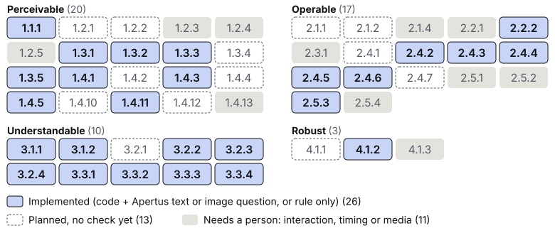

# Technical report — Klar.

**Meaning checks for an accessible Swiss web, with Apertus**

- **Track:** Track 2B — Own Project
- **Event:** Online
- **Team:** Klar — Mehdi Taleb (solo founder)
- **Demo:** [video URL]
- **Code:** [repo URL] (Apache-2.0) · **Dataset:** `track_2b/data/testset` in the repo (CDLA-Permissive-2.0; ACT cases under the W3C licence) · **Model:** Apertus v1.5 8B + 70B <!-- VERIFY: keep "+ 70B" only if the Phoeniqs run is reported in §5. -->

## 1. Summary

Accessibility scanners check that a link text, a label or a `lang` attribute *exists*, not that it *makes sense* to a screen-reader user: four links named "Mehr" without context pass, and so does an untagged French paragraph in a German page [4]. Most checks need human judgement [5, 6]; automated tools find 40–57 % of the issues [20, 21], and a clean scan does not mean an accessible page [22]. The W3C's ACT rules, its official test procedures, formalise some of these judgements (link in context, label, heading, image name, `lang` matches content [8–12, 45]); the W3C implementation report lists none of them for axe-core [13], and no rule covers an *untagged* passage [9].

Swiss federal sites must follow eCH-0059, the Swiss e-government accessibility standard, which adopts WCAG 2.1 AA, under the Disability Discrimination Act (BehiG) [1, 16, 17]. In 2025, only 5 of 70 municipal websites worked with a screen reader without obstacles [33]. Basel-Stadt bars confidential data from external AI tools [34], so cloud AI checkers are ruled out for intranets, pre-production sites and business applications. LLM judgement of such criteria is not new [23–26], but a 2026 review finds commercial GPT models dominate and sovereignty is not discussed [35].

**Klar.** pre-checks 26 of the 50 WCAG 2.1 A/AA criteria that eCH-0059 requires; it does not certify. Code computes every fact and settles clear cases. Apertus answers one closed question per remaining element, and an evidence guard discards ungrounded answers. A person accepts or rejects every finding. Klar. runs on-premise, air-gapped, with Apertus 70B in a Swiss cloud, or as a model-free replay.

**Headline result.** We evaluate [X] of the 26 implemented criteria on 605 generated test cases (German, French, Italian; a few English and Romansh), labelled and frozen before any test-split model call; W3C ACT cases are reported apart. The baseline is the same pipeline with every Apertus question left to a person, so the difference isolates the model. With Apertus 8B on one on-premise GPU, Klar. leaves [X] % of the checked elements to a person instead of [X] %; recall of real failures rises from [X] to [X] (McNemar p = [X]) at a precision of [X]; and [X] % of real failures are reported as passed (baseline [X] %). axe-core alone finds [X] % of the failures. A page costs CHF [X] on-premise. Apertus 70B on Phoeniqs reaches [X] precision and [X] recall.

## 2. Architecture

Klar. runs as two containers (Figure 1). The `app` container holds Python 3.12 (FastAPI), Playwright with Chromium, the vendored axe-core 4.13.0 [42] and a Vue 3 interface in EN/DE/FR/IT. The model runs in a second container (vLLM [40] on a GPU, llama.cpp on a CPU) or behind an OpenAI-compatible endpoint.

1. **Capture.** Playwright renders the URL or pasted HTML and records the DOM, Chromium's accessible names, the inherited `lang` and element crops.
2. **Facts.** axe-core runs its A/AA rules; presence and syntax failures stay its job. One module per criterion computes candidates and facts *in code*, following the SC text, Understanding, techniques and ACT rules [43–45]. Examples: the ACT link context for 2.4.4, where a preceding heading does not count because technique H80 is advisory [2, 8]; unrounded contrast ratios; the real Tab order; motion under a fake clock; lingua word shares [38]; a same-site page sample; form probes that send nothing to a server.
3. **Cascade.** An injection filter runs first: instruction-like text never reaches the model and is never passed by code. Rules and heuristics settle clear cases. Each remaining candidate gets one closed question to Apertus (§3), within a per-scan budget.
4. **Evidence guard.** An answer becomes `cantTell` (a person decides; counted as "not grounded") if its quote is not verbatim in the element, its selector does not resolve, or it cites a language code, number or URL absent from the element.
5. **Finding.** It carries an ACT/EARL outcome [7, 15], the criterion and EN 301 549 clause [18], the decider (rule, heuristic or Apertus), the quote, *the exact context the model saw*, the user impact and a fix.
6. **Review.** A person accepts or rejects each finding; exports are JSON, EARL, CSV and HTML. Unlike overlays [39], Klar. never alters the page.

<figure class="fig-wide">

<figcaption><b>Figure 1.</b> Data flow and deployment. Everything inside the red boundary runs on the organisation's own machine. Only the model endpoint changes between modes.</figcaption>
</figure>

**Coverage.** 26 criteria have a check module (Figure 2, Table 1). Five of them send an image crop (1.1.1, 1.4.1, 1.4.3, 1.4.5, 1.4.11), but contrast is always measured in code; two are rule checks decided in code (2.4.5, 3.2.3). Of the other 24, 11 need a person (interaction, timing or media that a page scan cannot judge) and 13 are planned. axe-core's rules run on every page, but Klar. claims no criterion from them.

<figure class="fig-narrow">

<figcaption><b>Figure 2.</b> The 50 WCAG 2.1 A/AA criteria at commit [commit], drawn from the criteria registry. Red outline: evaluated on the test split (§5).</figcaption>
</figure>

*Table 1. The 26 check modules. Apertus answers one closed question; code maps its category to an outcome.*

| Group | Criteria | Decided in code (examples) | Asked to Apertus (examples) |
|---|---|---|---|
| A. Forms | 1.3.5, 2.5.3, 3.2.2, 3.3.1–3.3.4, 4.1.2 | invalid `autocomplete` token; label words reordered in the name; error shown by colour only; state not updated after a click | whose data a field collects; does the error message name the field and the problem; is the submission final |
| B. Structure, navigation | 1.3.3, 2.4.2, 2.4.5, 2.4.6, 3.1.1, 3.2.3, 3.2.4 | file-name title; ways to reach each sampled page; order of repeated navigation; page language from word shares | what the title describes; does a heading or label describe its content [3, 10, 11]; does an instruction rely on sensory cues only |
| C. Colour, contrast | 1.4.1, 1.4.3, 1.4.5, 1.4.11 | contrast ratios; glyph pixels over images; links below 3:1 with no cue | (vision) logotype or content; image of text or exception; is colour the only cue |
| D. Order, focus, motion | 1.3.1, 1.3.2, 2.2.2, 2.4.3 | fake headings; spaced-out letters; positive `tabindex` across groups; motion over 5 s with no control | heading or lead-in; data or layout table; does the code order or focus order keep the meaning |
| Original three | 1.1.1, 2.4.4, 3.1.2 | file-name `alt`; generic link without context; full foreign sentence without `lang` | (vision) does the `alt` fit the crop; where the link purpose comes from; what a foreign span is |

### Target architecture (mandatory)

Klar. deploys in all three target architectures with the same images and code. **Build or install time:** container images and PyPI/npm packages, pinned by digest or exact version (axe-core and fonts are vendored), and the gated Apertus 8B weights, downloaded once (a, b). **Runtime:** the audited site (the page, its resources and bounded same-origin GETs) and the model endpoint: local (a, b), Phoeniqs (c) or none (replay). There is no CDN, web font, analytics or telemetry.

- **a) On-premise.** `make run-gpu` starts the official Apertus 1.5 vLLM image (pinned by digest) with `swiss-ai/Apertus-v1.5-8B` in BF16, with vision, on one RTX 5090 (32 GB) [28]. `HF_TOKEN` reaches only the model container, once. `make run-cpu` is a text-only llama.cpp fallback (Q4_K_M).
- **b) Air-gapped.** `make bundle` exports images and weights. `make airgap-check` runs the stack on an `internal` Docker network and passes only if the app container cannot reach four public hosts, the demo scan completes and `/api/health` answers. CI runs it on every push to `main` ([CI URL]).
- **c) Swiss cloud.** `LLM_BASE_URL`, `LLM_NAME` and `LLM_API_KEY` select Apertus 70B on Phoeniqs (`maas.phoeniqs.com/v1`, model `inference-apertus-v15-70b`), a listed Apertus provider [29]. Per question, only a short excerpt around one element (and, for vision, its crop) leaves. kvant/Phoeniqs documents Swiss sovereign infrastructure and no storage or logging of inference data on its Evaluation and Base plans [31]; we have not audited this. CSCS [30] is classified the same way, untested.

**Sovereignty badge.** The interface shows the mode, `local`, `swiss_cloud`, `external` or `replay`, derived from the endpoint host. Counters show the AI requests actually sent per destination, retries included.

**Security.** Page content enters prompts only as one JSON block declared untrusted; verdicts come only from enum fields; no request carries tools. One URL policy checks every browser request and redirect hop (http(s) only, link-local and metadata addresses blocked, private networks on opt-in); WebSockets are mocked and WebRTC is off. Forms are submitted and controls clicked only on the demo and evaluation servers; elsewhere, checks reload the page in an isolated context, GET only. Hard deadlines bound every scan (900 s). In tests, a honeypot with hostile redirects received only same-origin GETs and no POST.

**Replay mode.** Without `LLM_BASE_URL`, Klar. replays recorded answers of allow-listed Apertus models, keyed by model, prompt version and exact question (image bytes included); a miss yields `cantTell`. `make run` uses it on a clean checkout, with no key, download or network, and `make eval` recomputes §5 from the committed recordings, without a GPU.

## 3. Use of Apertus

- **Model:** `swiss-ai/Apertus-v1.5-8B` (Apache-2.0; text and image input) [28], revision `[X]`; `swiss-ai/Apertus-v1.5-70B` via Phoeniqs, whose served revision cannot be pinned. Every answer records the served model name and endpoint host.
- **How it is used:** inference only: no fine-tuning, no tools, no agents. Apertus is the only LLM at runtime; lingua is a statistical language identifier.
- **Where it runs:** local vLLM in BF16 (a, b), Phoeniqs (c), llama.cpp Q4_K_M for text only (CPU), or recorded answers (replay).

**Closed micro-questions.** Each question concerns one element. The JSON answer is validated against a per-check schema whose first field is a category enum, mapped to an outcome in code: for 2.4.4, where the purpose comes from (`link_text`, `context`, `nowhere`); for 3.1.2, what a span is (proper name, institution, loanword, foreign passage…). Then come a confidence, a verbatim `quote` (≤ 80 characters), a short English `reason` and, where useful, a `fix` in the content language. Code facts enter as context (measured ratios, word shares, a control's observed effect); a link's destination never does. Prompts do not depend on the interface language and contain no test or demo strings. 24 of the 26 checks can ask, under per-page caps.

**Why categories.** Asked "is the purpose clear?", the 8B model ignored a clear sentence context during development; asked *where* the purpose comes from, it reads the context. On a CPU run, it exempted a full French paragraph, so long foreign running text is now failed in code and never sent.

**Decoding.** Temperature 0, seed 42, `max_tokens` 100–180, thinking off: the questions are closed and come with their evidence. Start-up probes test JSON-schema decoding, `enable_thinking: false` and image input separately; without schema support, the schema goes in the prompt. An invalid answer gets one retry, then becomes `cantTell`.

**Vision and languages.** Contrast is always measured in code; from a crop, the model judges only meaning or exemptions such as logotypes. Without a vision backend, these questions end as `cantTell`. Apertus was trained on over 1,800 languages [27]. Language identifiers degrade on short text [38], so short or mixed spans and possible exceptions [4] go to Apertus: proper names, Helvetisms, Biel/Bienne.

## 4. Data

**Demo site.** "Gemeinde Musterwil" is a fictional municipality: 34 static pages in German, French and Italian with planted issues and traps, and 238 answer-key entries kept outside the served folder.

**Test set.** 994 manifest rows: 787 generated cases and 207 W3C ACT cases.

- **Generated.** A seeded generator builds each case from a written labelling protocol (v1.4): one decision rule per criterion and outcome, grounded in the SC text, Understanding, techniques and ACT rules. Labels follow from construction: no model judged any case. Outcomes: 38.9 % failed, 44.2 % passed, 15.0 % `cantTell` (documented borderline classes), 1.9 % inapplicable. 221 cases are exception traps. Languages: DE 284, FR 248, IT 242, EN 9, RM 4. 52 mini sites serve the site-level criteria; six cases hide prompt injections.
- **Split.** Whole template groups (including near-duplicates) go to dev (182) or test (605). The splits share no template and no decisive word.
- **W3C ACT.** 207 unmodified test cases of the 14 ACT *judgement* rules that map to 11 of our criteria [14]. Their expected outcome is the rule's, not the criterion's.

**Rigour.** The protocol predates the cases. The git tag `labels-v1` freezes the labels before any test-split run; the runner refuses the test split unless the manifest is byte-identical to the tagged one, and logs every test run. The AI agents read only the dev split while writing prompts, word lists and thresholds. A leakage check in CI finds 0 overlaps: no 8-word shingle of a test page occurs in the code, prompts or demo site, and dev shares no template or decisive word with test. The founder labels a blind, stratified 50-case sample (Cohen's κ = [X] [37]).

**Personal data and licences.** No personal data and no human subjects; all names are fictional. Each row names its licence: CDLA-Permissive-2.0 or W3C.

## 5. Evaluation

**Metrics.** The unit is a (case, criterion) pair, aggregated to the worst outcome; the positive class is `failed`, and gold-`cantTell` cases are left out of precision and recall. The *false-pass rate*, the worst error, counts real failures answered `passed` plus *silent misses* (no finding). *Flagged recall* also counts `cantTell`, which a person reviews; the *deferral rate* is that workload. Proportions carry Wilson 95 % intervals [36]. Paired comparisons use the exact McNemar test on decision correctness [41]; we claim no difference unless p < 0.05. This specification was frozen in code before the first test run.

**Systems.** All systems share one scan per case. *axe-core only* counts axe's raw verdicts, including those a check replaced. *Baseline (B)* is Klar. without Apertus: the same rules, heuristics, keyword lists and lingua, with every question to Apertus answered `cantTell`. *O1* uses Apertus 8B on-premise (RTX 5090), *O2* Apertus 70B on Phoeniqs. Ablations of O1: *−guard* undoes the guard's downgrades (same answers); *−context* asks without the computed context.

*Table 2. Test split, evaluated criteria pooled; positive class = failed; Wilson 95 % intervals. Generated (n = [X]) and ACT cases (n = [X]) are never pooled. p = exact McNemar test against B (generated cases).*

| System | Precision | Recall | False pass | Flagged recall | Deferral | p vs B | ACT P / R |
|---|---|---|---|---|---|---|---|
| axe-core only | [X] ([X]–[X]) | [X] ([X]–[X]) | [X] % | [X] % | [X] % | [X] | [X] / [X] |
| B — no Apertus | [X] ([X]–[X]) | [X] ([X]–[X]) | [X] % | [X] % | [X] % | — | [X] / [X] |
| O1 — 8B, on-premise | [X] ([X]–[X]) | [X] ([X]–[X]) | [X] % | [X] % | [X] % | [X] | [X] / [X] |
| O2 — 70B, Phoeniqs | [X] ([X]–[X]) | [X] ([X]–[X]) | [X] % | [X] % | [X] % | [X] | [X] / [X] |
| O1 −guard | [X] ([X]–[X]) | [X] ([X]–[X]) | [X] % | [X] % | [X] % | [X] | [X] / [X] |
| O1 −context | [X] ([X]–[X]) | [X] ([X]–[X]) | [X] % | [X] % | [X] % | [X] | [X] / [X] |

*Table 3. Test split by group (Table 1), generated cases: precision / recall, and false-pass rate.*

| Group | n (F/P/C/I) | B | O1 | O2 | False pass B / O1 / O2 |
|---|---|---|---|---|---|
| A. Forms | [X]/[X]/[X]/[X] | [X] / [X] | [X] / [X] | [X] / [X] | [X] / [X] / [X] |
| B. Structure, navigation | [X]/[X]/[X]/[X] | [X] / [X] | [X] / [X] | [X] / [X] | [X] / [X] / [X] |
| C. Colour, contrast | [X]/[X]/[X]/[X] | [X] / [X] | [X] / [X] | [X] / [X] | [X] / [X] / [X] |
| D. Order, focus, motion | [X]/[X]/[X]/[X] | [X] / [X] | [X] / [X] | [X] / [X] | [X] / [X] / [X] |
| Original three | [X]/[X]/[X]/[X] | [X] / [X] | [X] / [X] | [X] / [X] | [X] / [X] / [X] |

**Interpretation.** *Tiers:* rules decide [X] % of the cases (precision of `failed` [X]), heuristics [X] % ([X]) and Apertus [X] % ([X]). *Model contribution:* from B to O1, recall moves from [X] to [X] (p = [X]). O1 marks [X] % of exception traps as failed, against [X] % for B. It finds [X] of the 4 test cases of quoted foreign sentences without `lang`, which code never fails. *Grounding:* the guard changed [X] outcomes; without context, precision goes from [X] to [X]. *Robustness:* [X] of the 4 test injection cases end as `passed`. O1 recall is [X] (DE), [X] (FR) and [X] (IT). *Cost and sovereignty:* with O1, a page costs [X] s and [X] tokens: CHF [X] on-premise (hardware over [X] years, [X] W at CHF [X]/kWh). With O2, it costs CHF [X] on Phoeniqs (CHF 0.6195 / 2.2201 per million input / output tokens [31]). The budget counts real endpoint requests only; cache and replay hits are free. During O1, the counters recorded [X] local, [X] Swiss-cloud and [X] external AI requests. *Scale:* a 300-page site takes [X] h on one RTX 5090, one question at a time without batching, and leaves about [X] findings to review. A certification by Stiftung Zugang für alle costs CHF 3,800–8,500 (excl. VAT) and takes about four weeks [32]. Klar. triages before and between audits; it does not replace them.

## 6. Limitations

- **Labels and data.** Labels come from construction, with one annotator and a 50-case blind check. The synthetic cases are cleaner than real CMS pages, so results are an upper bound. The same team wrote the protocol, the cases and the checks, so they may share blind spots. No native speaker has checked the Romansh texts.
- **Per check.** *3.1.2:* quoted foreign sentences without `lang` are never failed in code, because quoted titles must stay exempt, so their recall depends on the model. *3.1.1:* lingua has no Romansh model, so Apertus decides there. *1.4.x:* contrast samples the background at the first glyph and ignores text in images, filters and blend modes; focus styles are read from stylesheets, without specificity or script-set styles; technique C30 and the hover/focus half of G183 are not checked. *4.1.2:* listeners delegated to an ancestor are unseen.
- **Interaction and site level.** On external sites, for safety, 2.2.2 and 2.4.3 click nothing and press no Enter, and ask a person to check; they reload the page in an isolated context, GET only (3 extra loads per page). 3.2.2 and 3.3.1–3.3.4 interact only on the demo and evaluation servers; elsewhere, only static evidence counts. 2.4.5, 3.2.3, 3.2.4 and duplicate titles (2.4.2) use a bounded same-origin sample (≤ 20 pages, 21 GETs, 15 s); robots.txt is not consulted.
- **Trust boundaries.** The injection filter is conservative: a hit turns a possible finding into "a person must check". The mode is inferred from the endpoint host, so a LAN proxy could forward requests elsewhere. A hostile page can fake its DOM, as with any scanner.
- **Models and scope.** The CPU fallback is a community Q4_K_M build without vision. No assistive-technology users were involved, and Klar. attests no conformance. The demo's screen-reader audio is simulated by a sighted person.

## 7. Reproducibility

- **Hardware and runtime.** One NVIDIA RTX 5090 (32 GB), CPU [X], [X] GB RAM, driver [X], Docker [X]; the vLLM image uses CUDA 13.0. Images are pinned by digest, dependencies by exact versions.
- **Determinism and versions.** Temperature 0, seed 42 per request, vLLM `--seed 0`, one request at a time, exact cache keys. Commit [commit] (tag [tag]); labels `labels-v1` (manifest sha256 [X]); per-check prompt versions in every key; replay recorded on [date]; `RUNLOG.jsonl` logs each test run.
- **Commands** (from `track_2b/`). `make run`: replay demo scan, under [X] min. `make eval`: `results.json` and `table.md`. `make run-gpu` / `make run-cpu`: local model. `make airgap-check`: offline proof. CI: [CI URL].

## 8. Next steps

- **Real pages.** Pilot on public-sector sites with a Swiss disability organisation; let blind and partially sighted screen-reader users set the thresholds; have Romansh reviewed by a native speaker.
- **Coverage and standards.** The 13 planned criteria (keyboard and focus first), PDF documents (EN 301 549 clause 10), WCAG 2.2 and EN 301 549 V4.1.1 [19], and report-only CI jobs.

## License

This report: Creative Commons Attribution 4.0 (CC-BY-4.0). Code: Apache-2.0. Data: CDLA-Permissive-2.0 (generated cases) and the W3C licence (ACT cases).

## References

1. W3C. *Web Content Accessibility Guidelines (WCAG) 2.1*. W3C Recommendation, 2018, updated 6 May 2025. <https://www.w3.org/TR/WCAG21/>
2. W3C WAI. *Understanding Success Criterion 2.4.4: Link Purpose (In Context)*. <https://www.w3.org/WAI/WCAG21/Understanding/link-purpose-in-context.html>
3. W3C WAI. *Understanding Success Criterion 2.4.6: Headings and Labels*. <https://www.w3.org/WAI/WCAG21/Understanding/headings-and-labels.html>
4. W3C WAI. *Understanding Success Criterion 3.1.2: Language of Parts*. <https://www.w3.org/WAI/WCAG21/Understanding/language-of-parts.html>
5. W3C. *WCAG Evaluation Methodology (WCAG-EM) 2.0*. W3C Group Note, 23 July 2026. <https://www.w3.org/TR/WCAG-EM/>
6. W3C WAI. *Selecting Web Accessibility Evaluation Tools*. <https://www.w3.org/WAI/test-evaluate/tools/selecting/>
7. W3C. *Accessibility Conformance Testing (ACT) Rules Format 1.1*. W3C Recommendation, 5 February 2026. <https://www.w3.org/TR/act-rules-format/>
8. W3C WAI. ACT rule 5effbb, *Link in context is descriptive*. <https://www.w3.org/WAI/standards-guidelines/act/rules/5effbb/>
9. W3C WAI. ACT rule off6ek, *HTML element language subtag matches language*. <https://www.w3.org/WAI/standards-guidelines/act/rules/off6ek/>
10. W3C WAI. ACT rule cc0f0a, *Form field label is descriptive*. <https://www.w3.org/WAI/standards-guidelines/act/rules/cc0f0a/>
11. W3C WAI. ACT rule b49b2e, *Heading is descriptive*. <https://www.w3.org/WAI/standards-guidelines/act/rules/b49b2e/>
12. W3C WAI. ACT rule qt1vmo, *Image accessible name is descriptive*. <https://www.w3.org/WAI/standards-guidelines/act/rules/qt1vmo/>
13. W3C WAI. *ACT implementation report: axe-core*. <https://www.w3.org/WAI/standards-guidelines/act/implementations/axe-core/>
14. ACT Rules Community Group. *Test cases* (`testcases.json`) and *License* (W3C Software and Document Notice and License). <https://act-rules.github.io/testcases.json>, <https://act-rules.github.io/pages/license/> (accessed 14 October 2026)
15. W3C. *Evaluation and Report Language (EARL) 1.0 Schema*. W3C Working Group Note, 2 February 2017. <https://www.w3.org/TR/EARL10-Schema/>
16. eCH. *eCH-0059 Accessibility Standard*, version 3.0, 2020. <https://www.ech.ch/de/ech/ech-0059/3.0>
17. Swiss Confederation. *Behindertengleichstellungsgesetz (BehiG)*, SR 151.3. <https://www.fedlex.admin.ch/eli/cc/2003/667/de>
18. ETSI, CEN, CENELEC. *EN 301 549 V3.2.1 (2021-03): Accessibility requirements for ICT products and services*. <https://www.etsi.org/deliver/etsi_en/301500_301599/301549/03.02.01_60/en_301549v030201p.pdf>
19. National Disability Authority (Ireland). *Updated EN 301 549 Standard Strengthens Accessibility Requirements for ICT Products and Services* (V4.1.1). <https://nda.ie/news/en301549-published>
20. Deque Systems. *Deque Study Shows Its Automated Testing Identifies 57 Percent of Digital Accessibility Issues*, 10 March 2021. <https://www.deque.com/blog/automated-testing-study-identifies-57-percent-of-digital-accessibility-issues>
21. UK Government Digital Service. *How do automated accessibility checkers compare?* (accessibility tool audit), 2018. <https://alphagov.github.io/accessibility-tool-audit/>
22. WebAIM. *The WebAIM Million: The 2026 report on the accessibility of the top 1,000,000 home pages*. <https://webaim.org/projects/million/>
23. J.-M. López-Gil, J. Pereira. Turning manual web accessibility success criteria into automatic: an LLM-based approach. *Universal Access in the Information Society* 24(1):837–852, 2025 (online 2024). doi:10.1007/s10209-024-01108-z
24. Z. He, S. F. Huq, S. Malek. Enhancing Web Accessibility: Automated Detection of Issues with Generative AI. *Proc. ACM Softw. Eng.* 2(FSE), 2025. doi:10.1145/3729371
25. N. Fathallah, D. Hernández, S. Staab. AccessGuru: Leveraging LLMs to Detect and Correct Web Accessibility Violations in HTML Code. *Proc. ASSETS 2025*. doi:10.1145/3663547.3746360
26. A. Mishra, P. Karthik, B. Bae, D. Yoon. Agentic Web Accessibility Auditing: A Criterion-Specific Framework for Translating WCAG Requirements into Assessments. arXiv:2609.09379, 2026.
27. Project Apertus. Apertus: Democratizing Open and Compliant LLMs for Global Language Environments. arXiv:2509.14233, 2025.
28. Swiss AI Initiative. *Apertus-v1.5-8B* and *Apertus-v1.5-70B* model cards. <https://huggingface.co/swiss-ai/Apertus-v1.5-8B>, <https://huggingface.co/swiss-ai/Apertus-v1.5-70B>
29. Apertus. *Inference Ecosystem* (Apertus 1.5 general availability), 17 September 2026. <https://www.apertus-ai.org/articles/2026-09-apertus-1-5-ga/>
30. CSCS. *LLM Inference API Service*. <https://docs.cscs.ch/services/inference/api/>
31. kvant / Phoeniqs. *Model Serving – Active Models* (models and prices, accessed 14 October 2026) and *FAQ: AI Model Service*. <https://documentation.kvant.cloud/maas/active-models/>, <https://documentation.kvant.cloud/faq/ai-model-service/>
32. Stiftung Zugang für alle. *Accessibility-Zertifizierung* (prices and duration). <https://access-for-all.ch/leistungen/zertifizierung/>
33. CORRECTIV. „Ein erschreckendes Bild": Gemeinde-Webseiten sind nicht barrierefrei, 27 October 2025 (with Stiftung Zugang für alle). <https://correctiv.org/barrierefreiheit/2025/10/27/diese-schweizer-gemeinde-websites-sind-nicht-barrierefrei/>
34. Regierungsrat des Kantons Basel-Stadt. Answer to Interpellation No. 147 on the use of Copilot Chat in the cantonal administration, 28 January 2026. <https://grosserrat.bs.ch/dokumente/100411/000000411872.pdf>
35. W. Aljedaani, R. H. Mollik. Large Language Models for Web Accessibility: A Systematic Literature Review. *W4A 2026*. arXiv:2605.13873
36. E. B. Wilson. Probable inference, the law of succession, and statistical inference. *JASA* 22(158):209–212, 1927. doi:10.1080/01621459.1927.10502953
37. J. Cohen. A coefficient of agreement for nominal scales. *Educational and Psychological Measurement* 20(1):37–46, 1960. doi:10.1177/001316446002000104
38. P. M. Stahl. *Lingua*: natural language detection for Python (`lingua-language-detector`, Apache-2.0). <https://github.com/pemistahl/lingua-py>
39. U.S. Federal Trade Commission. *FTC Approves Final Order Requiring accessiBe to pay $1 Million*, press release, 22 April 2025. <https://www.ftc.gov/news-events/news/press-releases/2025/04/ftc-approves-final-order-requiring-accessibe-pay-1-million>
40. W. Kwon et al. Efficient Memory Management for Large Language Model Serving with PagedAttention. *Proc. SOSP 2023*. doi:10.1145/3600006.3613165
41. Q. McNemar. Note on the sampling error of the difference between correlated proportions or percentages. *Psychometrika* 12(2):153–157, 1947. doi:10.1007/BF02295996
42. Deque Systems. *axe-core* 4.13.0, accessibility engine (MPL-2.0). <https://github.com/dequelabs/axe-core/tree/v4.13.0>
43. W3C WAI. *Understanding WCAG 2.1* (all Understanding documents). <https://www.w3.org/WAI/WCAG21/Understanding/>
44. W3C WAI. *Techniques for WCAG 2.1* (sufficient techniques and failures). <https://www.w3.org/WAI/WCAG21/Techniques/>
45. W3C WAI. *All ACT Rules*. <https://www.w3.org/WAI/standards-guidelines/act/rules/>
